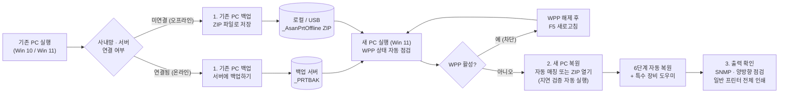
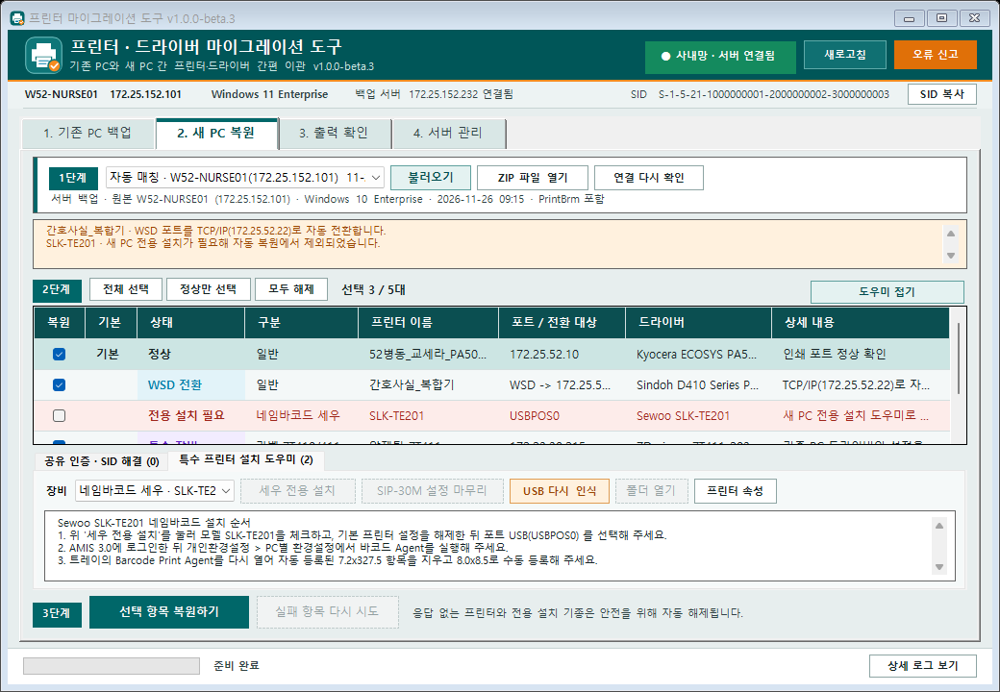
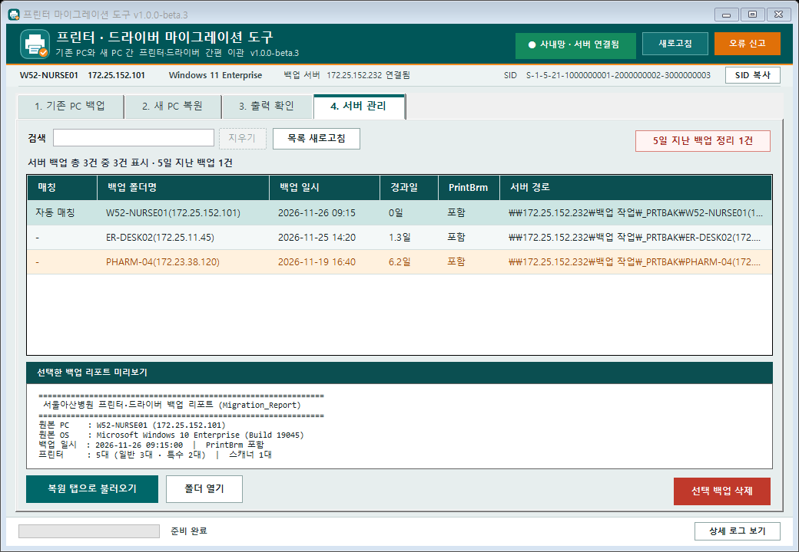

# 서울아산병원 프린터 · 드라이버 통합 마이그레이션 도구 (`v1.0.0-beta.3`)

> **기존 PC(Windows 10 / 11) → 새 PC(Windows 11) 교체 현장 전용 단일 실행 파일(`Asan_Printer_Manager.bat`) WinForms GUI 도구**  
> 외부 런타임 설치 **0개** · 원본 USB 쓰기 **0바이트(Zero USB Write)** · 사내망 온라인 / 오프라인 ZIP 겸용

서울아산병원 PC 교체 현장에서 기존 PC의 프린터 큐, 포트, 서드파티 드라이버, 바코드·진료카드·라벨 특수 장비 세부 설정, WIA 스캐너 드라이버를 무손실로 백업·복원하고, 병원 표준 인쇄 정책(`SNMP OFF`, 양방향 제어, WSD→TCP/IP 전환, WPP 차단)까지 한 번에 마무리할 수 있도록 설계된 현장 운영 유틸리티입니다.

---

## 목차

1. [핵심 특징 및 프로그램 명세](#1-핵심-특징-및-프로그램-명세)
2. [한눈에 보는 현장 교체 흐름](#2-한눈에-보는-현장-교체-흐름)
3. [화면별 사용 가이드 (실제 화면 캡처)](#3-화면별-사용-가이드-실제-화면-캡처)
4. [상태 색상 · 버튼 · 단축키 · 오류 자동 리포트 안내](#4-상태-색상--버튼--단축키--오류-자동-리포트-안내)
5. [현장 예외 상황 조치 가이드 (WPP · 동일 SID · 오프라인 ZIP)](#5-현장-예외-상황-조치-가이드-wpp--동일-sid--오프라인-zip)
6. [특수 · 라벨 프린터 5종 현장 체크리스트](#6-특수--라벨-프린터-5종-현장-체크리스트)
7. [프로젝트 구조 · 빌드 · 자동 검증 (관리자/개발자용)](#7-프로젝트-구조--빌드--자동-검증-관리자개발자용)

---

## 1. 핵심 특징 및 프로그램 명세

| 항목 | 상세 명세 |
| :--- | :--- |
| **배포 형태** | 단일 실행 파일 `dist/Asan_Printer_Manager.bat` *(로컬 `secrets.local.json` 주입 빌드, Git 비추적)* |
| **지원 운영체제** | **기존 PC:** Windows 10 / Windows 11 모두 지원 · **새 PC:** Windows 11 (x64) |
| **외부 의존성** | **0개** — Windows 내장 PowerShell 5.1 + `.NET Framework 4.x` + OS 내장 도구(`PrintBrm`, `pnputil`, `PrintUIEntry`)만 사용 |
| **Zero USB Write** | 실행 즉시 `%TEMP%\AsanPrinterMgr\`로 자가 복제(스테이징)하여 원본 USB·공유 폴더에 임시 파일·로그를 1바이트도 기록하지 않음 *(매체제어 SaferZone / BSone / DRM 안전, 종료 시 `%TEMP%` 자가 삭제)* |
| **네트워크 대응** | **사내망 온라인:** 사내 백업 서버(`172.25.152.232\_PRTBAK`) 자동 업로드·자동 매칭<br>**사내망 미연결:** 단일 ZIP 저장(`C:\_AsanPrtOffline` + 쓰기 가능 USB 동시 복사) → 새 PC 복원 시 자동 지연 검증 |
| **드라이버 · 설정 보존** | `PrintBrm` + 정밀 `oem*.inf` 추출 + `PrintUIEntry /Ss·/Sr`(`.dat`) + 프린터 레지스트리(`.reg`) 결합으로 기존 PC 드라이버·인쇄 기본 설정 최우선 보존 |
| **보안 · 현장 안전** | 백업 서버 SMB 자격증명 영구 저장 금지 및 종료 시 즉시 세션 해제 · 오류 리포트 비밀번호 `[REDACTED]` 자동 마스킹 · 가상/특수/LPT1 무드라이버 장비 자동 보호 |

> 전체 버전 변경 이력은 [CHANGELOG.md](./CHANGELOG.md), 현장 E2E 통합 테스트 시나리오는 [docs/E2E_TEST_CHECKLIST_v16.md](./docs/E2E_TEST_CHECKLIST_v16.md)를 참고해 주세요.

---

## 2. 한눈에 보는 현장 교체 흐름



### 빠른 실행 요약 (3분 가이드)
1. **기존 PC:** `Asan_Printer_Manager.bat` 더블클릭 → UAC **`예`** → **`1. 기존 PC 백업`** 자동 진단 확인 → **`서버에 백업하기`** *(망 미연결 시 **`ZIP 파일로 저장`**)*.
2. **새 PC:** 고정 IP·사내 DNS(`10.71.1.5`) 설정 후 실행 → 붉은 WPP 경고 배너가 뜨면 해제 후 `F5` → **`2. 새 PC 복원`** 자동 매칭 확인 *(또는 **`ZIP 파일 열기`**)* → **`선택 항목 복원하기`**.
3. **마무리:** 특수 프린터가 있으면 하단 **`특수 프린터 설치 도우미`** 절차 수행 → **`3. 출력 확인`**에서 SNMP·양방향 정상 여부 확인 후 **`일반 프린터 전체 인쇄`**.

---

## 3. 화면별 사용 가이드 (실제 화면 캡처)

> 아래 캡처는 현장 이해를 돕기 위해 비식별 예시 PC(`W52-NURSE01`)와 샘플 프린터로 렌더링한 실제 프로그램 화면입니다.

### ① `1. 기존 PC 백업` — 프린터·스캐너 사전 진단 및 백업

기존 PC가 Windows 10이든 Windows 11이든 서버에 일치하는 기존 백업이 없으면 자동으로 이 탭이 열리며 사전 진단이 시작됩니다.


* **자동 분류 및 5색 상태 표시:** 가상 프린터(PDF/XPS/Fax/OneNote 등)는 자동으로 숨겨지며, 필요 시 `가상 프린터도 함께 보기`로 확인할 수 있습니다.
* **사전 검증:** TCP/IP 포트 생존 확인, 공유 프린터 사내 공용 암호 3종 무인 인증, WSD 프린터 실제 IP 및 모델명 자동 추출을 한 번에 수행합니다.
* **스캐너 드라이버 자동 수집:** WIA 스캐너를 자동 백업 / 웹캠 제외 / `미분류 스캐너 선택`으로 분류하고 `twain_32` 구형 스캐너 존재 여부도 기록합니다.

<details>
<summary><b>사내망 미연결(오프라인) 환경 화면 보기</b></summary>

사내망에 연결되지 않은 PC에서는 상단 배지가 붉은 **`■ 사내망 미연결`**로 전환되고, **`서버에 백업하기`** 버튼이 점선 비활성 상태로 자동 잠기며 **`ZIP 파일로 저장`**으로 안내됩니다. 비활성 버튼에 마우스를 올리면 비활성화 사유가 툴팁으로 표시됩니다.


</details>

---

### ② `2. 새 PC 복원` — 1·2·3단계 선택 복원 & 인라인 도우미

새 PC에서 실행 시 현재 PC명·IP와 일치하는 백업이 서버에 있으면 자동으로 이 탭으로 이동해 백업을 불러옵니다.



* **`1단계` 백업 불러오기:** 드롭다운에서 다른 백업을 고르면 즉시 불러오며, 오프라인 ZIP은 **`ZIP 파일 열기`** 선택 시 **실시간 연결 확인(지연 검증)**이 자동 수행됩니다. 원본 PC의 운영체제(`Windows 10 / 11`)와 `PrintBrm` 포함 여부도 한눈에 확인됩니다.
* **영속 주의사항 배너:** WSD→TCP/IP 자동 전환, 특수 장비 전용 설치 필요, ZT411 인쇄 기본 설정 마무리, LPT1 포트 확인 등 백업·진단 시 기록된 주의 사항이 상단 배너에 유지됩니다.
* **`2단계` 대상 선택:** 응답 없는 프린터(`응답 없음`)와 새 PC 전용 설치가 필요한 `Sewoo SLK-TE201`(`전용 설치 필요`)은 안전을 위해 자동 해제/잠금됩니다.
* **하단 접이식 도우미:** 공유 인증 실패 호스트나 특수 프린터가 감지되면 **`공유 인증 · SID 해결`** / **`특수 프린터 설치 도우미`**가 자동으로 펼쳐집니다.
* **`3단계` 6단계 원자적 복원:**
  1. 골든 이미지 기존 가상 프린터 스냅샷 보존
  2. `PrintBrm` 복원 + 사후 정제(구형 `SEWOO_TE201`·`EPSON_TMT88_LPT` 유입 시 자동 격리 삭제)
  3. WSD→TCP/IP 또는 Local Port 자동 전환
  4. 2패스 드라이버 해결(기존 PC 추출 드라이버 최우선 → 로컬/골든 이미지 폴백)
  5. USB 바코드 프린터 소프트웨어 자동 재인식(`pnputil`)
  6. 스풀러 중지 상태 원자적 정책 적용(`SNMP OFF`, 양방향 제어, `.dat`/`.reg` 설정 주입) + 실패 항목만 골라 다시 실행하는 **`실패 항목 다시 시도`** 지원

---

### ③ `3. 출력 확인` — 병원 표준 정책 점검 및 일괄 테스트 인쇄

복원이 끝난 뒤 설치된 모든 프린터의 `SNMP`·`양방향` 레지스트리 상태를 점검하고 테스트 출력을 실행합니다.


* **위반 항목 즉시 강조:** 병원 표준 정책(`SNMP OFF`, 일반 프린터 `양방향 OFF`)을 위반한 항목은 빨강으로 강조되며, 상단 배너와 **`표준 설정 일괄 수정`** 버튼으로 한 번에 교정할 수 있습니다.
* **특수 바코드 안전 보호:** USB 직결 특수 바코드(`ZD410`, `TX220`, `SLK-TE201`)의 양방향 설정은 **`ON(유지)`**으로 보호되며, **`일반 프린터 전체 인쇄`**에서도 특수·라벨 프린터는 자동 제외됩니다.
* **단축 제어:** **`인쇄 대기열 초기화`**, **`선택 프린터 테스트 인쇄`**, **`프린터 속성`**, **`인쇄 기본 설정`**, **`기본 프린터로 지정`**을 한 화면에서 바로 실행할 수 있습니다.

---

### ④ `4. 서버 관리` — 백업 이력 검색 · 리포트 미리보기 · 5일 경과 정리

사내 백업 서버(`_PRTBAK`)에 저장된 백업 폴더를 검색하고 리포트를 미리 보거나 오래된 백업을 안전하게 정리합니다.



* **빠른 검색 및 미리보기:** PC명·IP 검색(`지우기` 버튼 연동)과 행 클릭 시 비동기 `Migration_Report` 미리보기를 제공합니다. 행을 더블클릭하거나 **`복원 탭으로 불러오기`**를 누르면 즉시 복원 탭으로 이동합니다.
* **안전한 5일 경과 정리:** 5일이 지난 백업은 주황색으로 구분 표시되며, **`5일 지난 백업 정리`** 및 **`선택 백업 삭제`**는 `_PRTBAK` 직계 하위·`PrinterBackup.*` 마커·심볼릭 링크(`ReparsePoint`) 차단 가드 하에서만 동작합니다. `_REPORTS` 등 `_` 접두어 시스템 폴더는 영구 제외됩니다.

---

## 4. 상태 색상 · 버튼 · 단축키 · 오류 자동 리포트 안내

### 네트워크 상태 배지 (상단 우측)
| 배지 표시 | 의미 | 가능한 작업 |
| :--- | :--- | :--- |
| **그린** `● 사내망 · 서버 연결됨` | 사내망 및 백업 서버(`172.25.152.232`) 정상 연결 | 서버 백업/복원 · 서버 관리 · 온라인 오류 리포트 전송 |
| **오렌지** `▲ 사내망 연결 · 서버 미응답` | 사내망 연결됨, 백업 서버 응답 지연/차단 | ZIP 파일 백업/복원 · 로컬 오류 리포트 저장 |
| **레드** `■ 사내망 미연결` | 병원 사내망 미연결 (오프라인) | ZIP 파일 백업/복원 · 로컬 오류 리포트 저장 |

### 비활성 버튼 & 툴팁 안내
* **점선 테두리 + 옅은 회색:** 현재 조건에서 누를 수 없는 버튼은 점선 테두리로 즉시 구분됩니다.
* **사유 툴팁:** 비활성 버튼에 마우스를 올리면 왜 비활성화되어 있는지(예: `사내망 백업 서버에 연결되어 있지 않습니다`, `현재 작업이 진행 중입니다`)가 툴팁으로 즉시 표시됩니다.
* **표(그리드) 말줄임 툴팁:** 긴 드라이버명·서버 경로·상세 내용 셀에 마우스를 올리면 전체 문장을 볼 수 있습니다.

### 작업 중 오류 자동 리포트 구성 (온·오프라인 대응)
* 상단 **`오류 신고`** 버튼으로 언제든 수동 리포트를 보낼 수 있습니다.
* 백업·복원·인증·정책 수정 등 **작업 중 오류가 발생하면** 앱이 PC 환경·네트워크·프린터/포트/장치관리자 상태·실행 로그를 자동 수집해 리포트 전송(또는 저장) 여부를 즉시 안내합니다.
  * **사내망 연결 시:** 백업 서버 `_PRTBAK\_REPORTS\`로 즉시 전송
  * **사내망 미연결 시:** 이 PC의 `C:\_AsanPrtOffline\_Reports\`에 저장하고 탐색기 폴더 열기 안내
  * **민감정보 자동 보호:** 공용 암호·세션 암호·JSON 이스케이프 변형까지 모두 `[REDACTED]`로 마스킹

### 전역 단축키
* `Alt + 1` ~ `Alt + 4`: 1~4번 탭 즉시 전환
* `F5`: 네트워크 · WPP · 백업 서버 목록 전체 새로고침

---

## 5. 현장 예외 상황 조치 가이드 (WPP · 동일 SID · 오프라인 ZIP)

### ① Windows 11 보호 인쇄 모드(WPP) 해제
Windows 11 24H2 이후 **Windows 보호 인쇄 모드(WPP)**가 켜져 있으면 서드파티 드라이버 복원이 OS 차원에서 차단됩니다. WPP가 감지되면 상단에 **붉은 경고 배너**가 뜨고 복원 버튼이 안전하게 잠깁니다.

1. **로컬 설정으로 켜진 경우:** 경고 배너의 **`프린터 설정 열기`** 클릭 *(또는 `Win+I` → `Bluetooth 및 장치` → `프린터 및 스캐너`)* → 하단 `프린터 기본 설정` → **`Windows 보호 인쇄 모드`** 끄기 → 본 프로그램에서 **`F5`**.
2. **그룹 정책(GPO)으로 강제된 경우:** 경고 배너의 **`조치 방법 안내`** 확인 → `gpedit.msc` → `컴퓨터 구성` → `관리 템플릿` → `프린터` → **`Windows 보호 인쇄 구성`**을 `사용 안 함` 또는 `구성되지 않음`으로 변경 후 관리자 CMD에서 `gpupdate /force` 실행 → **`F5`**. *(정책 수정이 제한된 경우 IT서비스팀 시스템 관리자에게 해제 요청)*

### ② 동일 Windows Machine SID 충돌 복구
동일한 골든 이미지 PC 간 공유 프린터(`\\IP\공유명`) 연결 시 비밀번호가 맞는데도 인증이 거부(Win32 `5` / `86` / `1326` / `1331` / `1909`)될 수 있습니다.

1. **`2. 새 PC 복원`** 하단에 자동으로 펼쳐진 **`공유 인증 · SID 해결`** 탭에서 실패 호스트 IP와 오류 안내를 확인합니다.
2. 메인 PC 암호가 바뀐 경우: 아이디·암호 입력 후 **`다시 인증`** 클릭.
3. 암호가 맞는데도 거부되는 경우: 상단 **`SID 복사`**로 현재 PC의 SID를 메인 PC와 대조 → 메인 PC SID 변경·스풀러 조치 완료 후 새 PC에서 **`스풀러 초기화 후 재연결`** 클릭.
4. 인증이 풀리면 **`실패 항목 다시 시도`**를 눌러 정상 복원된 프린터는 건드리지 않고 실패했던 공유 프린터만 정밀 복원합니다.

### ③ 오프라인 ZIP 백업 및 새 PC 지연 검증
1. 사내망이 끊긴 기존 PC에서 **`ZIP 파일로 저장`** 클릭 → `C:\_AsanPrtOffline\`과 쓰기 가능한 USB(`<USB루트>\_AsanPrtOffline\`)에 전체 프린터·드라이버·설정을 단일 ZIP으로 저장합니다.
2. 사내망에 연결된 새 PC의 **`2. 새 PC 복원`**에서 **`ZIP 파일 열기`**로 해당 ZIP을 선택합니다.
3. **실시간 연결 확인(지연 검증)**이 자동 실행되어 꺼진/폐기 프린터(`응답 없음`)는 기본 해제되고, WSD 프린터는 TCP/IP 전환 준비 상태로 표시됩니다.

---

## 6. 특수 · 라벨 프린터 5종 현장 체크리스트

특수 장비는 PCL6 자동 전환 및 **`일반 프린터 전체 인쇄`**에서 자동 제외됩니다.

| 장비 구분 | 자동 복원 정책 | USB 양방향 | 현장 핵심 마무리 |
| :--- | :--- | :---: | :--- |
| **진료카드 `SIP-30M`** (`id카드`) | 2버튼 반자동 설치 + 4개 탭 설정 주입 | - | `전용 설치 실행` → `SIP-30M 설정 마무리` → AMIS 출력 확인 |
| **네임바코드 `Sewoo SLK-TE201`** | 복원 체크 **잠금** + 구형 큐/드라이버 격리 삭제 | `ON(유지)` | Win 11 전용 설치 실행 → Barcode Agent 수동 등록(`8.0 × 8.5`) |
| **약제 라벨 `Zebra ZT410 / ZT411`** | **기존 PC 드라이버 + 설정 최우선 복원** · 부재 시 골든 로컬 폴백 | USB 시 `ON(유지)` | 대체 복원 경고 시 인쇄 기본 설정 또는 로컬 `.drx`/`.drs` 불러오기 |
| **검사·투약 `Zebra ZD410 / ZD411`** | 드라이버 선등록 + `pnputil` USB 자동 재인식 | `ON(유지)` | `상태확인: 사용안함`, 여백 확인, 미인식 시 `USB 다시 인식` |
| **팔찌바코드 `BIXOLON SLP-TX220`** | 드라이버 선등록 + `pnputil` USB 자동 재인식 | `ON(유지)` | `Darkness 11~12`, `Landscape`, `Rotate 180`, `Black Mark` |
| **LPT1 영수증 `EPSON TM-T88VI`** | **무드라이버 정책** — 백업/복원 제외 · 유입 시 자동 격리 삭제 | - | 장치관리자 `LPT1` 포트 인식 여부만 확인 후 AMIS 바로 출력 |

<details>
<summary><b>장비별 상세 설치 · 확인 순서 펼치기</b></summary>

#### ① 진료카드 발급기 (`SIP-30M` / `id카드`)
1. 도우미 **`전용 설치 실행`**(`sip30inst`) → `표준 로컬(USB) 설치` 선택 → 장치 미연결 경고창에서 **`아니오`** → `마침`.
2. 도우미 **`SIP-30M 설정 마무리`** 클릭 → TCP/IP 포트(SNMP OFF) 생성, 중복 `id카드` 정리, 백업된 4개 탭 설정(`.dat`/`.reg`) 자동 주입.
3. 자동 팝업되는 **인쇄 기본 설정**(리본/코팅/농도/MS쓰기) 확인 후 담당자에게 AMIS 테스트 요청.

#### ② 네임바코드 (`Sewoo SLK-TE201`)
1. 도우미 **`세우 전용 설치`** 클릭 → 모델 `SLK-TE201` 체크 → `기본 프린터 설정` 해제 → 포트 `USB(USBPOS0)` 또는 `LPT1` 선택.
2. AMIS 3.0 로그인 → `개인환경설정` → `PC별 환경설정` → 바코드 Agent 실행.
3. 트레이 `Barcode Print Agent` 재실행 → 자동 등록된 `SLK-TE201(7.2×327.5)` 삭제 → **수동 등록(`8.0 × 8.5`)** 추가.

#### ③ 검사 · 투약 · 약제 바코드 (`Zebra ZD410 / ZD411 / ZT410 / ZT411`)
* **약제팀 `ZT411` (`ZDesigner ZT411-203dpi ZPL`):** 기존 PC 추출 드라이버 + `.dat`/`.reg` 인쇄 기본 설정 자동 복원을 최우선 시도합니다. 부득이 기존 드라이버가 없을 때만 골든 이미지 공통 로컬 경로(`C:\Users\admin\드라이버(win10_x64)\AMIS 3.0 장비\ZT411 (약국용 신형라벨프린터)\ZD8-6-5-26125\ZDesigner.inf`)로 대체 복원하며, `zd86526125-certified.exe` 재실행 시 뜨는 마법사에서는 설정하지 말고 **`나가기`**로 닫은 뒤 INF를 지정합니다. 대체 복원 경고가 뜨면 **인쇄 기본 설정**에서 로컬 용지별 `.drx`/`.drs`를 불러옵니다.
* **USB 직결 (`ZD410/411`):** 복원 중 `pnputil` 소프트웨어 자동 USB 재인식을 시도하며, 미인식 시 도우미의 **`USB 다시 인식`** 버튼 또는 케이블 1회 재연결로 승격합니다.
* **현장 확인:** 프린터 속성 → 드라이버 설정 → `상태확인: 사용안함`, 용지/상단 여백(검사 `5.5×3.0 / 2.6mm` · 투약 `5.5×6.0 / 1.0mm` · 약제 로컬 `.drx`/`.drs`) 및 AMIS 출력 확인.

#### ④ 팔찌바코드 (`BIXOLON SLP-TX220`)
1. 복원 중 소프트웨어 자동 USB 재인식 + `.dat`/`.reg` 설정 복원(미인식 시 **`USB 다시 인식`** 또는 USB 1회 재연결).
2. 기본 설정 → `Options`: **Darkness `11~12`** *(13 이상 QR 오류)*, `mm`, `Landscape`, `Rotate 180`, 성인 `20×250` / 소아 `20×150`.
3. `Advanced Setup`: 감열지(`Direct Thermal`) / 리본(`Thermal Transfer`) 구분, `Sensor: Black Mark`. 안 보일 경우 재부팅 후 AMIS `Barcode Print Agent` 자동 등록 확인.

#### ⑤ LPT1 무드라이버 유선 직결 장비 (`EPSON TM-T88VI`)
1. LPT 패럴렐 케이블을 유선 연결합니다. *(드라이버·바코드 에이전트 설치 금지)*
2. **`2. 새 PC 복원`** 상단 배너 또는 장치관리자(`devmgmt.msc`) → `포트(COM & LPT)`에서 **`LPT1`** 인식 여부만 확인합니다. *(타 포트 `LPT2`/`LPT3`로 잡힌 경우 포트 번호를 `LPT1`로 변경)*
3. 별도 프린터 추가 없이 AMIS 3.0에서 바로 출력해 확인합니다.

</details>

---

## 7. 프로젝트 구조 · 빌드 · 자동 검증 (관리자/개발자용)

```text
asan-printer-manager/
├── VERSION                         # 단일 SemVer 기준 파일 (1.0.0-beta.3)
├── AGENTS.md                       # Antigravity IDE 자동 로드 프로젝트 규칙
├── HANDOFF.md                      # 집 ↔ 직장 PC 양방향 인수인계서
├── CHANGELOG.md                    # 버전별 상세 변경 이력
├── README.md                       # 사용자 매뉴얼 및 프로그램 명세 (본 문서)
├── secrets.local.example.json      # 로컬 병원 공용 암호 템플릿 (secrets.local.json 복사, Git 비추적)
├── .agents/skills/asan-desktop-ui/ # 타 아산병원 툴 공용 Antigravity GUI 디자인 시스템 스킬
├── src/                            # 9개 모듈 소스 (UTF-8 With BOM + CRLF, 00_bootstrap은 No BOM)
│   ├── 00_bootstrap.bat                # Zero-USB-Write 스테이징, WOW64 Sysnative, Base64 UAC, %TEMP% 자가 삭제
│   ├── 01a_ctx_win32.ps1               # $global:AsanCtx 전역 컨텍스트 + C# 5.0 NativeApi P/Invoke
│   ├── 01b_net_diag.ps1                # WPP, 네트워크/SID/SMB, 특수장비·LPT·USB 재인식, WSD·스캐너 진단
│   ├── 01c_driver_inf.ps1              # 다국어 INF 파싱/인덱싱, 2패스 드라이버 해결, oem*.inf 추출
│   ├── 01d_backup_restore.ps1          # 온라인/ZIP 백업, 지연 검증, 6단계 복원·원자적 정책 엔진
│   ├── 01e_special_report_snapshot.ps1 # 특수장비 핸들러, SID 복구, 서버관리, 버그리포트, Core 스냅샷
│   ├── 02_gui_shell_tab1.ps1           # WinForms 셸, 비활성 점선/툴팁, New-PaddedTextBoxPanel, 탭 1
│   ├── 03_gui_tab2.ps1                 # 탭 2 복원, 지연 검증, 공유/SID 및 특수 장비 도우미
│   └── 04_gui_tab3_tab4_main.ps1       # 탭 3 출력 확인, 탭 4 서버 관리, 메인 진입점 + exit 99
├── scripts/                        # Windows PowerShell 5.1 네이티브 빌드·검증 스위트
│   ├── build_single_bat.ps1        # src/ + secrets.local.json 병합 → dist/Asan_Printer_Manager.bat
│   ├── verify_static.ps1           # 6대 자동 정적 검증 (인코딩·동기화·추출·AST·제약·C# 5.0·Runspace)
│   └── smoke_test_local.ps1        # 비파괴 로컬 스모크 테스트 (부트스트랩·단위테스트·GUI 4탭 레이아웃)
├── dist/
│   └── Asan_Printer_Manager.bat    # 로컬 빌드 단일 실행 파일 (.gitignore 처리 — 사내 경로/USB 직접 배포)
└── docs/
    ├── images/                     # README 안내용 비식별 실제 GUI 캡처 5종
    ├── E2E_TEST_CHECKLIST_v16.md   # 현장 E2E 통합 테스트 체크리스트 (TC-01 ~ TC-22)
    └── antigravity_ide_v16_0.md    # 초기 마스터 개발 설계 원본
```

### 최초 1회 로컬 비밀 설정 (안 A — Git 평문 암호 분리)
1. 저장소 루트의 `secrets.local.example.json`을 `secrets.local.json`으로 복사합니다.
2. `secrets.local.json`의 `DefaultPasswords`에 병원 공용 암호 3종을 입력합니다. *(Git에서 `.gitignore`로 영구 제외됩니다.)*

### 로컬 단일 `.bat` 빌드 및 3단계 자동 검증 (Windows PowerShell 5.1)

```powershell
# 1. 단일 .bat 무손실 빌드 (secrets.local.json 자동 주입)
powershell -NoProfile -ExecutionPolicy Bypass -File .\scripts\build_single_bat.ps1

# 2. 6대 자동 정적 검증 (ALL 6/6 CHECKS PASSED 확인)
powershell -NoProfile -ExecutionPolicy Bypass -File .\scripts\verify_static.ps1

# 3. 비파괴 로컬 스모크 테스트 (ALL 3/3 TESTS PASSED · 레이아웃 오류 0건 · exit 99 확인)
powershell -NoProfile -ExecutionPolicy Bypass -File .\scripts\smoke_test_local.ps1
```
