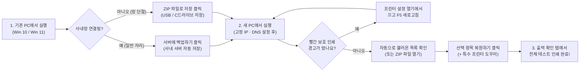
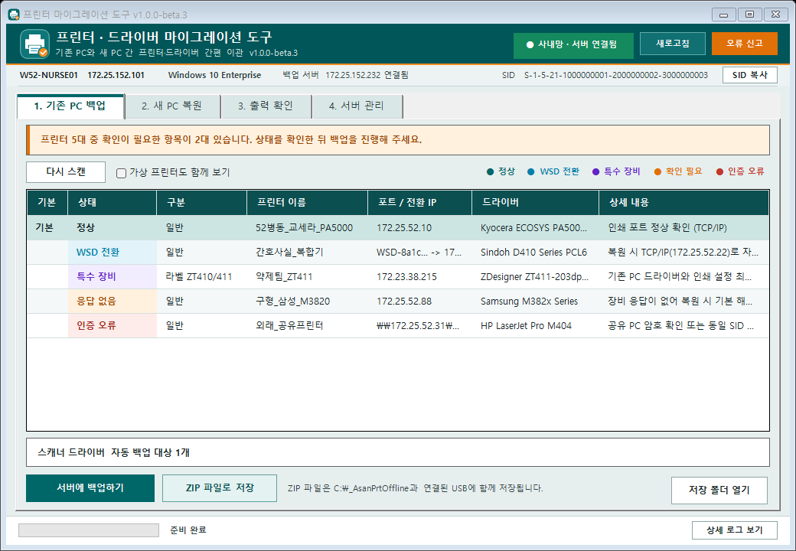
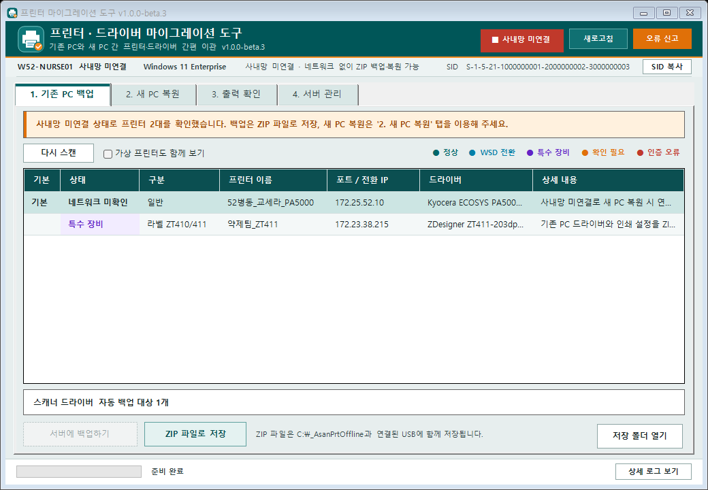
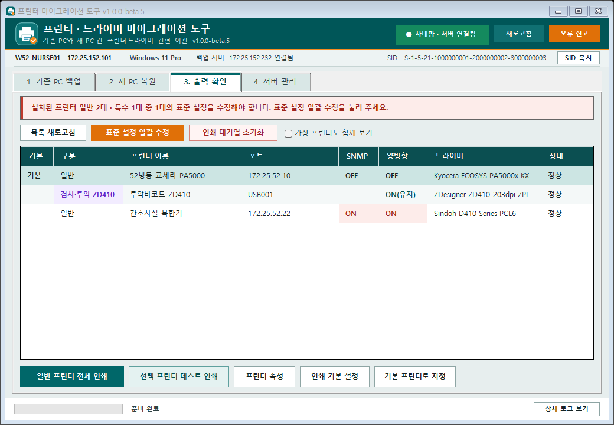

# 서울아산병원 프린터 · 드라이버 마이그레이션 도구 (`v1.0.0-beta.6`)

> **컴퓨터를 새 PC로 교체할 때, 기존 PC에 쓰던 프린터·바코드기·스캐너를 버튼 몇 번으로 그대로 옮겨 주는 프로그램입니다.**  
> 별도 설치 불필요 · 설정 파일 만들기 불필요 · **`Asan_Printer_Manager.bat` 파일 딱 1개만 받아 실행하면 끝!**

---

## 목차

1. [가장 빠른 다운로드 & 3분 사용법](#1-가장-빠른-다운로드--3분-사용법)
2. [한눈에 보는 전체 작업 순서](#2-한눈에-보는-전체-작업-순서)
3. [화면별 쉬운 설명](#3-화면별-쉬운-설명)
4. [상태 표시 · 버튼 · 오류 자동 신고 안내](#4-상태-표시--버튼--오류-자동-신고-안내)
5. [자주 만나는 상황별 해결법](#5-자주-만나는-상황별-해결법)
6. [특수 · 바코드 프린터 기종별 마무리 방법](#6-특수--바코드-프린터-기종별-마무리-방법)
7. [프로그램 상세 명세 및 개발자 안내](#7-프로그램-상세-명세-및-개발자-안내)

---

## 1. 가장 빠른 다운로드 & 3분 사용법

### 준비물: 실행 파일 딱 1개!
1. 이 페이지 오른쪽의 **[Releases](https://github.com/nikin78/asan-printer-manager/releases)** 메뉴로 들어갑니다.
2. 가장 위에 있는 최신 버전에서 **`Asan_Printer_Manager.bat`** 파일 1개만 내려받아 작업용 USB(또는 폴더)에 넣습니다.
   * 파이썬 같은 다른 프로그램을 깔 필요도 없고, 암호 설정 파일을 따로 만들 필요도 없습니다.
   * USB에서 바로 실행해도 USB에 임시 파일이나 찌꺼기를 남기지 않아 병원 보안 환경에서도 안전합니다.

---

### 따라 하기만 하면 끝나는 3단계

#### 1단계 — 기존 PC에서 백업하기 (Windows 10 · Windows 11 모두 가능)
1. 기존 PC에서 `Asan_Printer_Manager.bat`을 더블클릭하고, 관리자 권한 창이 뜨면 **`예`**를 누릅니다.
2. 잠시 기다리면 이 PC에 설치된 프린터 목록이 자동으로 나타납니다.
3. 왼쪽 아래 **`서버에 백업하기`** 버튼을 누르면 사내 백업 서버(`172.25.152.232`)에 자동 저장됩니다.
   * *만약 랜선이 뽑혀 있거나 사내망이 안 되는 자리라면?* 바로 옆 **`ZIP 파일로 저장`**을 누르면 `C:\_AsanPrtOffline` 폴더와 연결된 USB에 압축 파일로 한 번에 저장됩니다.

#### 2단계 — 새 PC에서 복원하기 (Windows 11)
1. 새 PC에 랜선을 꽂고 **고정 IP와 사내 DNS(`10.71.1.5`)**를 먼저 설정한 뒤, `Asan_Printer_Manager.bat`을 실행합니다.
2. PC 이름이나 IP가 같으면 알아서 **`2. 새 PC 복원`** 화면이 열리고 방금 백업한 목록이 자동으로 불러와집니다.
   * *서버에 백업이 너무 많아 찾기 어렵다면?* **`서버 검색`** 버튼을 눌러 이전 PC 이름이나 IP만 치면 바로 찾을 수 있습니다.
   * *ZIP 파일로 백업했다면?* **`ZIP 파일 열기`** 버튼을 눌러 저장해 둔 ZIP 파일을 선택하면 됩니다.
3. *(중요)* 만약 화면 위쪽에 **빨간색 경고줄(`Windows 보호 인쇄 모드`)**이 떴다면, 경고줄의 **`프린터 설정 열기`**를 눌러 기능을 끄고 키보드 **`F5`**(새로고침)를 눌러 주세요.
4. 아래 **`선택 항목 복원하기`** 버튼을 누르면 프린터와 드라이버, 인쇄 설정이 자동으로 설치됩니다.
   * 복원이 깔끔하게 끝나면 **"출력 확인 탭으로 바로 이동할까요?"** 창이 뜨며, **`예`**(또는 엔터)만 누르면 바로 테스트 인쇄 화면으로 넘어갑니다.
   * 바코드 프린터나 진료카드 발급기가 있는 자리라면 화면 아래쪽에 자동으로 열린 **설치 도우미 안내**를 보고 순서대로 마무리해 주세요.

#### 3단계 — 잘 나오는지 확인하기
1. **`3. 출력 확인`** 탭을 누릅니다.
2. 위쪽에 주황색 **`표준 설정 일괄 수정`** 버튼이 켜져 있다면 한 번 눌러 병원 표준 설정(인쇄 지연 방지)으로 자동 교정합니다.
3. 아래 **`일반 프린터 전체 인쇄`** 버튼을 눌러 테스트 종이가 정상으로 나오면 작업 완료입니다! *(바코드·라벨지가 아깝게 출력되지 않도록 특수 프린터는 전체 인쇄에서 알아서 제외됩니다.)*

---

## 2. 한눈에 보는 전체 작업 순서



---

## 3. 화면별 쉬운 설명

> 아래 화면들은 이해를 돕기 위해 가상의 병동 예시(`W52-NURSE01`)로 만든 실제 프로그램 화면입니다.

### ① `1. 기존 PC 백업` — 지금 쓰는 프린터 확인하고 저장하기



* PDF, 팩스, OneNote 같은 기본 가상 프린터는 헷갈리지 않게 자동으로 숨겨 줍니다.
* 지금 켜져 있는 정상 프린터인지, 구형 연결 방식(`WSD`)이라 새 PC에서 안정적인 `TCP/IP` 방식으로 자동 변환해 줄 대상인지 색깔로 쉽게 보여 줍니다.
* 스캐너 드라이버가 깔려 있으면 아래 칸에서 함께 챙겨 줍니다.

<details>
<summary><b>사내망이 연결되지 않은 PC에서는 어떻게 보이나요? (클릭해서 보기)</b></summary>

사내망이 안 되는 PC에서는 오른쪽 위가 빨간 **`■ 사내망 미연결`**로 표시되고, 사용할 수 없는 **`서버에 백업하기`** 버튼은 점선으로 흐리게 바뀝니다. 흐린 버튼에 마우스를 올리면 왜 못 누르는지 설명이 뜨고, 바로 옆 **`ZIP 파일로 저장`**으로 안내해 줍니다.



</details>

---

### ② `2. 새 PC 복원` — 백업 불러와서 새 PC에 한 번에 설치하기


* **`1단계`:** 서버에 저장된 내 PC 백업을 자동으로 찾아 주며, **`서버 검색`**으로 다른 PC 백업을 빠르게 찾거나 **`ZIP 파일 열기`**로 불러올 수도 있습니다.
* **주의사항 안내 상자:** 자동 전환되는 프린터나 별도 마무리가 필요한 특수 장비가 있으면 주황색 상자에 쉬운 문장으로 미리 알려 줍니다.
* **`2단계`:** 꺼져 있거나 안 쓰는 것으로 보이는 프린터(`응답 없음`), 그리고 새 PC 전용 설치가 꼭 필요한 세우 바코드(`SLK-TE201`)는 사고 방지를 위해 체크가 자동으로 빠져 있습니다.
* **아래쪽 도우미 창:** 공유 프린터 암호 문제나 특수 바코드 프린터가 있을 때만 자동으로 열리며, 선택한 장비에 꼭 필요한 버튼만 깔끔하게 보여 줍니다.
* **`3단계`:** **`선택 항목 복원하기`**를 누르면 복원이 시작되며, 혹시 일부 공유 프린터만 실패했더라도 나중에 **`실패 항목 다시 시도`**로 그 프린터만 빠르게 다시 설치할 수 있습니다. *(새 Windows 11 PC에서 옆 자리 구형 PC 공유 프린터 연결이 윈도우 보안 정책으로 막히더라도 알아서 우회 연결까지 시도해 줍니다!)*

---

### ③ `3. 출력 확인` — 인쇄 멈춤 방지 설정 & 테스트 인쇄



* 병원 프린터에서 흔히 생기는 '오프라인 멈춤' 현상을 막으려면 일반 프린터의 `SNMP`와 `양방향` 기능이 꺼져(`OFF`) 있어야 합니다.
* 켜져 있는 항목(`ON`)은 빨간 칸으로 눈에 띄게 표시되며, **`표준 설정 일괄 수정`** 버튼 하나로 전부 고칠 수 있습니다. *(단, 양방향 통신이 꼭 필요한 USB 바코드 프린터는 건드리지 않고 안전하게 `ON(유지)`로 보호합니다.)*
* 인쇄가 밀려 안 나올 때 쓰는 **`인쇄 대기열 초기화`**, **`프린터 속성`**, **`인쇄 기본 설정`**, **`기본 프린터로 지정`** 버튼도 한곳에 모여 있습니다.

---

### ④ `4. 서버 관리` — 백업 목록 찾기 & 오래된 백업 정리


* 서버에 올라가 있는 백업 폴더를 PC 이름이나 IP로 바로 검색할 수 있고, 클릭하면 아래 칸에 어떤 프린터가 백업됐는지 미리 보여 줍니다.
* 항목을 더블클릭하거나 **`복원 탭으로 불러오기`**를 누르면 바로 복원 화면으로 넘어갑니다.
* 만들어진 지 5일이 지난 백업은 주황색으로 표시되며, **`5일 지난 백업 정리`** 버튼으로 서버 용량을 안전하게 비울 수 있습니다.

---

## 4. 상태 표시 · 버튼 · 오류 자동 신고 안내

### 오른쪽 위 네트워크 상태 배지
| 화면 표시 | 무슨 뜻인가요? | 어떻게 하면 되나요? |
| :--- | :--- | :--- |
| **초록** `● 사내망 · 서버 연결됨` | 사내망과 백업 서버(`172.25.152.232`)에 정상 연결됨 | 그대로 서버 백업·복원을 진행하면 됩니다. |
| **주황** `▲ 서버 로그인 필요` | 서버는 보이지만 서버 암호가 기본값에서 변경됨 | 상단 **`서버 로그인`** 버튼을 눌러 바뀐 암호를 입력합니다. |
| **주황** `▲ 사내망 연결 · 서버 미응답` | 사내망은 됐지만 백업 서버가 잠시 응답하지 않음 | **`ZIP 파일로 저장`** / **`ZIP 파일 열기`**로 작업할 수 있습니다. |
| **빨강** `■ 사내망 미연결` | 랜선·고정 IP·DNS가 아직 연결되지 않음 | 네트워크 설정을 확인하거나 ZIP 파일 방식으로 작업합니다. |

### 알아두면 편한 기능
* **점선 버튼 이유 안내:** 눌리지 않는 점선 버튼 위에 마우스를 살짝 올려 두면 *"왜 비활성화되었는지"* 말풍선으로 바로 알려 줍니다.
* **오류 자동 신고:** 작업 도중 혹시 오류가 나면, 프로그램이 알아서 PC 상태와 기록을 모아 **서버 리포트함으로 보낼지(망 미연결 시 내 PC 폴더에 저장할지)** 물어봅니다. 상단 주황색 **`오류 신고`** 버튼으로 직접 보낼 수도 있습니다.
* **단축키:** `Alt + 1~4`(탭 바로 이동), `F5`(네트워크·서버 다시 확인)

---

## 5. 자주 만나는 상황별 해결법

### ① 빨간색 `Windows 보호 인쇄 모드` 경고가 뜰 때
Windows 11 최신 버전에서 이 기능이 켜져 있으면 교세라·삼성·바코드 드라이버 설치를 윈도우가 무조건 막아 버립니다.
1. 빨간 경고줄 오른쪽의 **`프린터 설정 열기`**를 누릅니다.
2. 열리는 윈도우 설정 창 맨 아래쪽에서 **`Windows 보호 인쇄 모드`**를 **끄기**로 바꿉니다. *(만약 회사 정책으로 잠겨 있다면 경고줄의 `조치 방법 안내`를 참고해 `gpedit.msc`에서 해제하거나 시스템 관리자에게 요청합니다.)*
3. 프로그램으로 돌아와 **`F5`**(또는 `새로고침`)를 누르면 빨간 줄이 사라지고 복원할 수 있습니다.

### ② 옆 자리 PC가 공유해 준 프린터가 `인증 오류`라고 뜰 때
다른 PC에 연결된 공유 프린터(`\\IP\프린터이름`)는 두 가지 이유로 막힐 수 있습니다. **`2. 새 PC 복원`** 아래쪽에 자동으로 열린 **`공유 인증 · SID 해결`** 탭에서 해결합니다.
* **옆 자리 PC 비밀번호가 기본 암호가 아닌 경우:** 그 PC의 윈도우 로그인 아이디·암호를 적고 **`다시 인증`**을 누릅니다.
* **암호가 맞는데도 거부되는 경우 (동일 SID 충돌):** 같은 복제 이미지로 설치된 PC끼리 고유 번호(`SID`)가 겹쳐 윈도우가 접속을 막는 현상입니다. 오른쪽 위 **`SID 복사`**로 번호를 확인하고, 메인 PC 조치 후 새 PC에서 **`스풀러 초기화 후 재연결`** → **`실패 항목 다시 시도`**를 순서대로 누르면 이미 설치된 프린터는 건드리지 않고 공유 프린터만 깔끔하게 다시 잡아 줍니다.

---

## 6. 특수 · 바코드 프린터 기종별 마무리 방법

바코드·라벨·진료카드 장비는 용지와 여백이 중요하므로 아래 표를 보고 마무리해 주세요. 프로그램 화면 아래 **`특수 프린터 설치 도우미`**에서도 똑같은 안내와 바로가기 버튼을 제공합니다.

| 장비 종류 | 자동 복원 여부 | 현장에서 꼭 확인할 마무리 |
| :--- | :--- | :--- |
| **진료카드 발급기 (`SIP-30M` / `id카드`)** | 도우미 버튼 2번으로 반자동 완료 | 도우미에서 `전용 설치 실행` 완료 후 → `SIP-30M 설정 마무리` 클릭 → AMIS 테스트 요청 |
| **네임바코드 (`Sewoo SLK-TE201`)** | 구형 드라이버 충돌 방지를 위해 **새 PC 전용 설치 필수** | 도우미 `세우 전용 설치` 실행 → AMIS 바코드 Agent 실행 후 `8.0 × 8.5` 수동 등록 |
| **약제 라벨 (`Zebra ZT410 / ZT411`)** | **기존 PC 드라이버·설정 최우선 자동 복원** | 만약 대체 드라이버로 복원됐다는 안내가 뜨면 `인쇄 기본 설정`에서 용지 설정(`.drx`/`.drs`) 불러오기 |
| **검사·투약 바코드 (`Zebra ZD410 / ZD411`)** | 자동 복원 + USB 자동 재인식 | 미인식 시 도우미 `USB 다시 인식` 클릭, 속성에서 `상태확인: 사용안함` 및 여백 확인 |
| **팔찌바코드 (`BIXOLON SLP-TX220`)** | 자동 복원 + USB 자동 재인식 | 농도(`Darkness`) `11~12` 확인 *(13 이상은 QR 인식 오류)*, 안 보이면 재부팅 후 AMIS 확인 |
| **영수증 (`EPSON TM-T88VI` · `LPT1` 선 연결)** | **원래 드라이버를 깔면 안 되는 장비** (자동 제외·정리) | 드라이버 설치 금지! 장치관리자에서 **`LPT1`** 포트만 잡혀 있으면 AMIS에서 바로 출력됨 |

<details>
<summary><b>기종별 세부 설정 수치 자세히 보기 (클릭해서 펼치기)</b></summary>

* **진료카드 (`SIP-30M`):** `전용 설치 실행`(`sip30inst`)에서 `표준 로컬(USB) 설치` 선택 → 장치 미연결 창에서 **`아니오`** → `마침` → 도우미 **`SIP-30M 설정 마무리`** 클릭(포트·이름 `id카드`·기존 4개 탭 설정이 자동 적용됨).
* **네임바코드 (`Sewoo SLK-TE201`):** `세우 전용 설치`에서 `SLK-TE201` 체크, `기본 프린터 설정` 해제, 포트 `USB(USBPOS0)`(또는 `LPT1`) 선택 → AMIS 3.0 `개인환경설정 > PC별 환경설정`에서 바코드 Agent 실행 → 작업 표시줄 트레이 `Barcode Print Agent`를 열어 자동 등록된 `7.2×327.5` 삭제 후 **`8.0 × 8.5`** 수동 등록.
* **약제 라벨 (`ZT411`):** 기존 PC 설정이 그대로 복원되면 바로 사용 가능합니다. 기존 PC 드라이버가 없어 골든 이미지 기본 드라이버(`C:\Users\admin\드라이버(win10_x64)\AMIS 3.0 장비\ZT411 (약국용 신형라벨프린터)`)로 대체 설치된 경우에만 `인쇄 기본 설정 > 가져오기/내보내기 설정`에서 해당 폴더의 용지별 `.drx`/`.drs` 파일을 불러와 주세요. *(수동으로 `zd86526125-certified.exe`를 실행했을 때 뜨는 마법사 창은 설정하지 말고 꼭 **`나가기`**로 닫아야 합니다.)*
* **검사·투약 (`ZD410/411`):** 검사바코드 `5.5×3.0`(상단 여백 `2.6mm`) · 투약바코드 `5.5×6.0`(상단 여백 `1.0mm`) · 드라이버 설정 `상태확인: 사용안함`.
* **팔찌 (`SLP-TX220`):** `Options`에서 `Darkness 11~12`, `mm`, `Landscape`, `Rotate 180`, 성인 `20×250` / 소아 `20×150`, `Sensor: Black Mark`.

</details>

---

## 7. 프로그램 상세 명세 및 개발자 안내

> 일반 사용자분들은 여기부터는 읽지 않으셔도 됩니다. 유지보수 및 코드 수정 시 참고하는 기술 명세입니다.

### 핵심 기술 명세 (`v1.0.0-beta.6`)
* **단일 파일 무의존성 구조:** Windows 기본 PowerShell 5.0/5.1 + `.NET Framework 4.x` + 인라인 C# 5.0 Win32 P/Invoke(`AsanWin32.NativeApi`)로 구성되어 외부 런타임이 전혀 필요하지 않습니다(구형 Windows 10 초기 빌드 `1507`/`1511`부터 최신 Windows 11 `24H2`까지 모두 호환, 전 모듈 `PSScriptAnalyzer` 경고 0건).
* **골든 이미지 손상 · WMI 오류 완벽 대응 네이티브 엔진:** 병원 골든 이미지 PC에서 흔히 발생하는 WMI 클래스 오류(`잘못된 클래스입니다` / `0x80041010`), 비활성화된 인쇄 스풀러, 구형/손상된 `pnputil` 환경에서도 멈추지 않도록 프린터 조회·등록·삭제·기본 지정(`winspool.drv` `EnumPrintersW` / `AddPrinterW` / `DeletePrinter(PRINTER_ALL_ACCESS)` / `AddPrinterConnectionW` / `SetDefaultPrinterW`), Machine SID(`netapi32.dll` `NetUserModalsGet`), 네트워크/라우팅(`.NET NetworkInterface` + 망분리 가상 스위치 필터링), 드라이버 추출(`DriverStore\FileRepository` 및 `INF\oem*.inf` `[Strings]` 토큰 해석 폴백), LPT·USB 진단(`DEVICEMAP\PARALLEL PORTS` 및 `pnputil` 폴백)을 모두 네이티브/레지스트리 기반으로 동작시킵니다.
* **Windows 11 공유 프린터 차단 자동 우회:** Windows 11(`22H2`~`24H2`)에서 작업 그룹 공유 프린터 연결 시 발생하는 RPC/Point-and-Print 오류(`0x0000011b` / `0x00000709` / `0x00000bcb`)를 방지하기 위해 `RpcUseNamedPipeProtocol=1` 호환 정책을 자동 적용하고, 호스트+공유명 정밀 검증 후 원격 드라이버 다운로드가 차단될 경우 로컬 포트(`\\IP\공유명`) + 로컬 x64 드라이버 방식으로 자동 우회 복원(기본 프린터 지정 포함)합니다.
* **강화된 백업 서버 SMB 인증:** 기본 공용 계정(`admin` + 3종 암호)이 내장되어 별도 파일 없이 즉시 연결되며, 기존 세션 우선 재사용 및 공유 경로 직접 인증(`admin` / `IP\admin` / `.\admin` 다중 포맷 + `NetShareEnum` 디스크 공유 탐색)을 수행합니다.
* **보안 및 안전 가드:** 실행 종료 시 백업 서버 SMB 세션 즉시 해제, 오류 리포트 전송 시 비밀번호 `[REDACTED]` 마스킹, 빈 백업(0대) 덮어쓰기 방지 확인 가드, 스풀러 중지 상태 원자적 레지스트리 정책 적용, `_PRTBAK` 직계 하위 및 마커 검증 가드.
* 버전별 변경 내역: [CHANGELOG.md](./CHANGELOG.md) · 현장 테스트 시나리오: [docs/E2E_TEST_CHECKLIST_v16.md](./docs/E2E_TEST_CHECKLIST_v16.md)

### 소스 폴더 구조 및 빌드·검증 명령 (개발자용)

```text
asan-printer-manager/
├── VERSION                         # 단일 버전 기준 (1.0.0-beta.6)
├── AGENTS.md / HANDOFF.md          # AI 에이전트 작업 규칙 및 집↔직장 인수인계서
├── README.md / CHANGELOG.md        # 사용자 가이드 및 변경 이력
├── .agents/skills/asan-desktop-ui/ # 아산병원 데스크톱 툴 공용 GUI 디자인 시스템 스킬
├── src/                            # 9개 분리 모듈 (00_bootstrap.bat + 01a~01e 코어 + 02~04 GUI)
├── scripts/                        # 빌드(build_single_bat) · 정적검증(verify_static) · 스모크(smoke_test_local)
└── docs/                           # 안내용 캡처(images/) 및 E2E 체크리스트
```

코드를 수정한 뒤에는 Windows PowerShell 5.1에서 아래 3단계를 실행해 단일 실행 파일(`dist\Asan_Printer_Manager.bat`)을 갱신하고 검증합니다.

```powershell
powershell -NoProfile -ExecutionPolicy Bypass -File .\scripts\build_single_bat.ps1
powershell -NoProfile -ExecutionPolicy Bypass -File .\scripts\verify_static.ps1
powershell -NoProfile -ExecutionPolicy Bypass -File .\scripts\smoke_test_local.ps1
```
